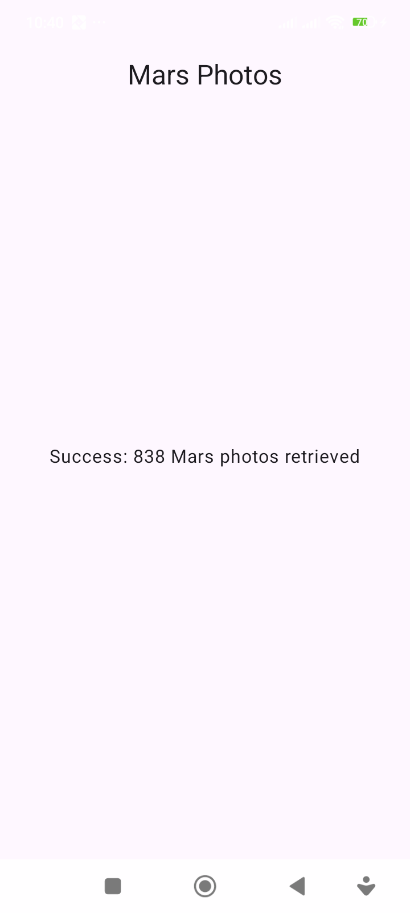
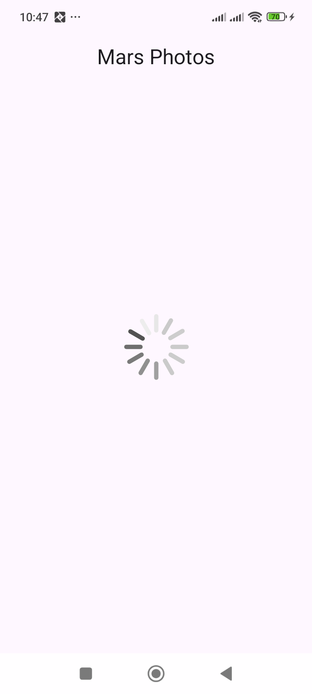
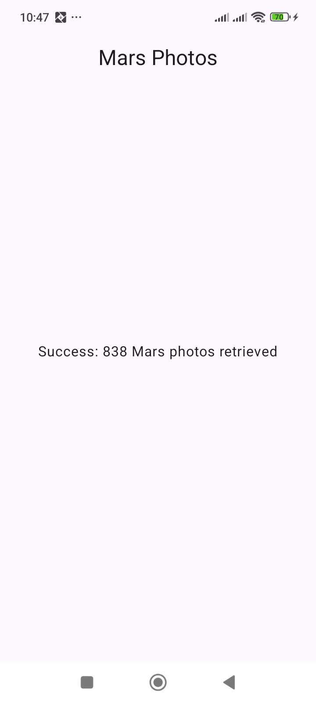
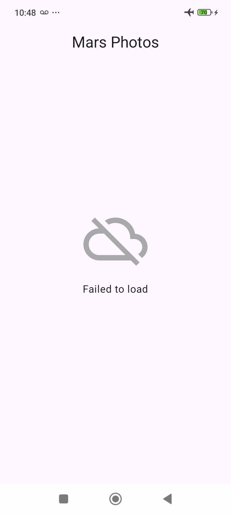
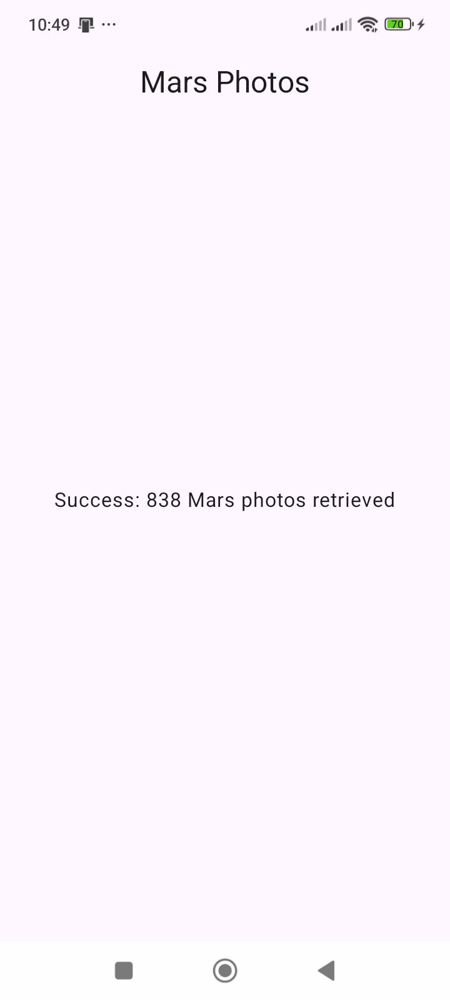

# Pruebas gráficas de Mars Photos

Realizadas el 28 de octubre de 2026 en un teléfono Xiaomi 23100RN82L, Android 15/API 35, pantalla de 720 × 1600. El usuario autorizó continuar con las pruebas de la aplicación que ya estaba en ejecución. Se revisó el dispositivo directamente mediante ADB y su vista en Android Studio.

## Resultado

| Prueba | Resultado observado |
| --- | --- |
| Aplicación inicialmente en ejecución | Barra superior `Mars Photos` y mensaje `Success: 838 Mars photos retrieved`. |
| Correspondencia con el servicio | Consulta real al endpoint oficial: HTTP 200 y array de 838 registros, con campos `id` e `img_src`. El conteo coincide con el mostrado por la aplicación. |
| Carga en arranque frío | Se capturó el indicador original `loading_img` antes de la respuesta. Se observó la transición posterior a Success sin alterar la red, los datos ni el código para simular resultados. |
| Contraste de barra de estado | Antes de corregir: hora e iconos blancos apenas visibles sobre el fondo claro. Después: hora e iconos oscuros legibles. |
| Sin Internet | Se activó modo avión y se desactivó Wi-Fi; tras relanzar, apareció el icono original de conexión y `Failed to load`. |
| Ausencia de cierre en Error | El proceso de la app siguió activo. La consulta del búfer de fallos de Logcat filtrada por ese proceso no encontró registros de cierre fatal. |
| Restauración de Internet | Se restituyeron modo avión desactivado y Wi-Fi activado, los estados originales del dispositivo. Al relanzar la aplicación apareció `Success: 838 Mars photos retrieved`. |
| Atrás y reapertura | Atrás llevó al lanzador del teléfono; al abrir de nuevo Mars Photos se mostró el conteo correcto. La aplicación quedó abierta y con Internet restaurado. |
| Compilación y análisis tras corregir | `:app:assembleDebug :app:lintDebug`: `BUILD SUCCESSFUL`; Lint: 0 errores y 25 advertencias. Se instaló y probó el APK de esta compilación. |

Los 838 registros son el valor observado durante estas pruebas, no un valor fijo de la aplicación ni una garantía sobre respuestas futuras del servidor. El ViewModel continúa calculando `listResult.size`.

## Única corrección de código

Commit `352605c`: `fix: corregir contraste de la barra de estado con el tema oficial`.

Se retiraron de `ui/theme/Theme.kt` las importaciones y el bloque `SideEffect` que imponían `statusBarColor` e `isAppearanceLightStatusBars`. La actividad ya utilizaba `enableEdgeToEdge`; el bloque heredado interfería con el contraste de la barra del sistema en el teléfono probado.

El archivo resultante es **idéntico** al de la [solución oficial repo-starter](https://github.com/google-developer-training/basic-android-kotlin-compose-training-mars-photos/blob/ba9470a0471df003e2044cc9a7124ea5ad1047b3/app/src/main/java/com/example/marsphotos/ui/theme/Theme.kt), comprobado con `git diff --quiet`. No se añadieron pantallas, componentes, dependencias, permisos ni funcionalidades. El resto del flujo REST, serialización y estados conserva la implementación del codelab.

## Configuración de compilación preservada

Al iniciar esta sesión existía un cambio local ajeno a esta revisión en `gradle/wrapper/gradle-wrapper.properties`: Gradle 9.5.0 → 9.8.2. Se conserva sin modificar ni incluir en los commits de corrección y evidencias.

Para comprobar la configuración versionada y publicada, la compilación de estas pruebas utilizó directamente la distribución Gradle 9.5.0 ya instalada, con Java 25, sin restaurar ni sobrescribir el wrapper local. El APK corregido proviene de esa compilación.

## Capturas reales

Estas imágenes se obtuvieron del dispositivo. Se conservan únicamente pantallas de la aplicación y sus barras del sistema; las capturas del lanzador y los registros ajenos a Mars Photos no se publican.

### Contraste antes de corregir

### Estado Loading

### Estado Success después de corregir

### Estado Error en modo avión y sin Wi-Fi

### Recuperación al restaurar Internet y relanzar

## Límites de la comprobación

La verificación gráfica se realizó en este dispositivo y su configuración actual. No se simularon errores HTTP del servidor, ni se probaron otros tamaños de pantalla o versiones de Android. No se ejecutaron los ejemplos unitarios o instrumentados de la plantilla. Las demostraciones didácticas de las versiones intermedias sin permiso, con JSON crudo o sin try-catch no se reprodujeron sobre el teléfono; siguen identificadas como no ejecutadas en el registro histórico. No se añadieron mecanismos de reintento o recuperación automática: la recuperación se verificó relanzando la app, como indica el codelab.
